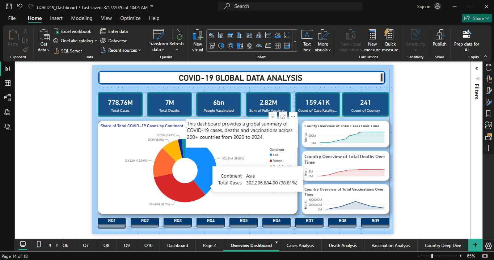
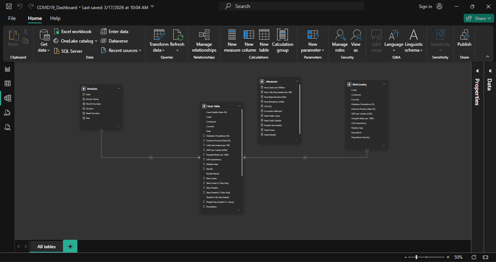

# COVID-19 Global Data Analysis (Power BI)

A multi-page Power BI report on global COVID-19 cases, deaths and vaccinations across 200+ countries from 2020 to 2024. I built it as a test project while learning Power BI as a trainee at **HiiT PLC** (a one-month assignment brief).



---

## Dataset

- **Source:** [Our World in Data](https://ourworldindata.org/covid-deaths), COVID-19 compact dataset (CSV). Data credit: Our World in Data; please check their licence and citation terms before reusing it.
- **Downloaded:** February 7th, 2026.
- The CSV is not included in this repository because of its size. Download it from the link above to rebuild the report.

## Research questions

1. Which 10 countries had the highest total COVID-19 deaths?
2. How did new daily cases trend globally across pandemic waves (2020-2023)?
3. Which countries had the highest case fatality rate?
4. Which continents had the highest full vaccination rates?
5. How did the global vaccination rollout progress month by month?
6. What is the distribution of total COVID-19 cases across continents?
7. Which countries had the highest total vaccinations?
8. What was the average reproduction rate (R) across continents?
9. Which countries recorded the highest peak daily death counts?
10. How did a country's cases, deaths and vaccinations evolve?

## What I did

1. **Cleaned the data in Power Query** from start to finish, preparing the raw CSV for analysis.
2. **Modelled the data** as a star schema: a country dimension, a date dimension and a fact table.
3. **Wrote DAX measures** for total cases, total deaths, case fatality rate, peak daily deaths, people vaccinated, total vaccinations, average fully vaccinated per 100 people and average reproduction rate.
4. **Built the report:** one page per research question (Q1 to Q10), then an overview dashboard and four analysis pages with navigation between them.

## Report pages

| Page | Purpose |
|---|---|
| Research Questions | The 10 questions that guide the analysis |
| Q1 to Q10 | One chart per research question |
| Overview Dashboard | Global summary of cases, deaths and vaccinations |
| Cases Analysis | Case waves and the most affected countries and continents |
| Death Analysis | Mortality and case fatality rate |
| Vaccination Analysis | Rollout speed and coverage by continent |
| Country Deep Dive | Cases, deaths and vaccinations over time for one country |



## Repository structure

```
covid-19-dashboard/
|-- README.md
|-- COVID19_Dashboard.pbix
|-- screenshots/
```

## Tools

Power BI Desktop, Power Query, DAX

## What I would do differently now

This was my first Power BI project, and my later project, [Operation Pulse](https://github.com/NextGenDataDev/operation-pulse), applies what I learned:

- Use named DAX measures for every number, not default aggregations.
- Add a proper date table and month-over-month comparisons.
- Design with a custom theme and a consistent grid instead of the default look.
- Reconcile results against a second tool (Python and SQL) before reporting them.

## Author

**Adeladan Muteeyah**, Computer Science, University of Ibadan
[LinkedIn](https://www.linkedin.com/in/muteeyah-adeladan-b0336328b)
